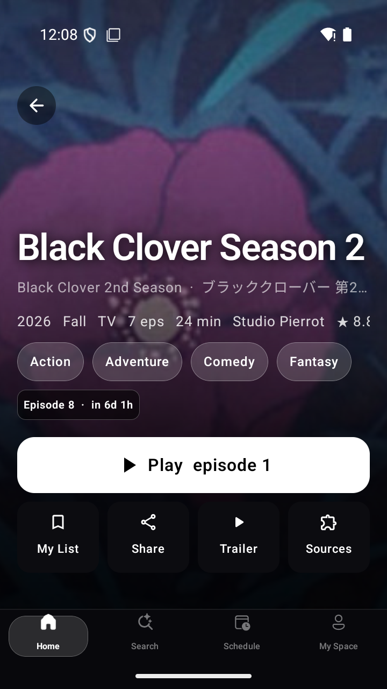

<div align="center">
  

  <h1>AniKitty</h1>

  <p>Your AniList, on the phone. The catalog comes from AniList. The video plays with Media3.</p>

  <p>
    <a href="https://github.com/fampep/anikitty/releases/latest"></a>
    <a href="https://github.com/fampep/anikitty/releases"></a>
    <a href="https://github.com/fampep/anikitty/releases/latest"></a>
    <a href="https://github.com/fampep/anikitty/releases"></a>
    <a href="https://github.com/fampep/anikitty/releases"></a>
    <a href="https://github.com/fampep/anikitty/actions/workflows/dev-release.yml"></a>
    <a href="https://github.com/fampep/anikitty/blob/main/LICENSE"></a>
    
  </p>
</div>

> [!WARNING]
> AniKitty is an unofficial app. It is not affiliated with AniList, MyAnimeList, or any studio or streaming service. Sideload APKs only from the [official releases](https://github.com/fampep/anikitty/releases) of this repository. Dev builds can be unstable.

## Why AniKitty

- The catalog is AniList. Search, the season, and a title page all use it.
- The player is Media3, on the phone.
- Watch progress stays on the device. Sign in when you want that progress on your AniList list.
- **Anikoto**, **Gotaku**, and **reanime** are compiled in, so a fresh install can play.
- Anything else is an extension you add. The app does not preload a community extension.

## Download

Package `site.anikitty.app`. Android 8 or newer.

A push to `main` publishes a signed dev build. Those land roughly every day. Stable releases are cut less often. Dev builds are newer and can be unstable. The badges above follow the releases. Nothing in this file hard-codes a version.

<p align="center">
  <a href="https://github.com/fampep/anikitty/releases/latest"></a>
  &nbsp;
  <a href="https://github.com/fampep/anikitty/releases/download/dev/anikitty-dev.apk"></a>
</p>

Stable opens the latest stable release. Dev downloads `anikitty-dev.apk`, a rolling build that moves with `main`. Numbered builds stay on the [releases page](https://github.com/fampep/anikitty/releases).

Allow installs from the browser, then open the file. If Android refuses an update because the signature does not match, uninstall the old app first.

## Screenshot

Public AniList catalog, night theme, on a phone. This is not a signed-in account, and it is not the sample library.

<p align="center">
  
</p>

## Features

- Home shows a featured title, a large continue card, what is airing, and this season.
- Search filters the AniList catalog and offers live title suggestions as you type.
- A title page resumes at the saved position. The button shows the exact time.
- The player is Media3. Double-tap either side to skip 10 seconds. Hold to play faster. Swipe down on the page bar or the episode shelf to leave for the library.
- Episodes are a thumbnail row. The current one shows minutes left. The next three sit underneath. Swipe a thumbnail up to mark it watched or unwatched.
- Sub and dub are a chip on the player bar. Autoplay shows a countdown you can dismiss.
- My Space sorts the library by newest, most watched, or name, and shows minutes logged this week.
- Settings can open the player full screen, pick an accent for the dark theme, remind you about a show you left, and export watch progress as JSON. The export does not include the AniList token.
- The player chrome stays dark. The rest of the app follows the system theme. Reduced motion turns off the extra movement.

The download icon on the player is a stub. AniKitty streams. It does not save the episode.

## Extensions

Only a resolver can supply a stream. The app sends an AniList id, an episode number, the audio mode, and a title hint. The resolver returns URLs. Media3 plays one of them. A community extension is an HTTP manifest (`anikitty-extension.json`), not code loaded into the app. It does not receive the AniList token.

| | |
|---|---|
| Author guide | [`extensions/GUIDE.md`](extensions/GUIDE.md) |
| Protocol | [`extensions/spec/PROTOCOL.md`](extensions/spec/PROTOCOL.md) |
| Submit a listing | [`extensions/store/SUBMIT.md`](extensions/store/SUBMIT.md) |
| Public index | [`fampep/anikitty-extensions`](https://github.com/fampep/anikitty-extensions) |
| Disclaimer | [`extensions/DISCLAIMER.md`](extensions/DISCLAIMER.md) |

## Build from source

```bash
cd apps/android
./gradlew :app:assembleRelease
```

The APK is `apps/android/app/build/outputs/apk/release/`. The version comes from the repo-root [`VERSION`](VERSION) file. GitHub Actions bumps that file when it publishes a dev prerelease. It does not edit this README.

| | |
|---|---|
| App | Kotlin, Jetpack Compose, Media3, Room |
| Catalog | AniList GraphQL |
| Sources | `extensions/` — guide, protocol, and store index |
| Bundled resolvers | Anikoto, Gotaku, reanime |

## FAQ

<details>
<summary>Is AniKitty an official AniList app?</summary>

No. AniKitty is an unofficial client. It is not affiliated with AniList, MyAnimeList, or any studio or streaming service.
</details>

<details>
<summary>Where should I download it?</summary>

Only from the <a href="https://github.com/fampep/anikitty/releases">releases of this repository</a>. Stable is <a href="https://github.com/fampep/anikitty/releases/latest">the latest stable release</a>. The rolling dev file is <a href="https://github.com/fampep/anikitty/releases/download/dev/anikitty-dev.apk"><code>anikitty-dev.apk</code></a>.
</details>

<details>
<summary>How often is it updated?</summary>

A push to <code>main</code> publishes a signed dev build. Those land roughly every day. Stable releases are cut less often.
</details>

<details>
<summary>Does the app host episodes?</summary>

No. AniKitty does not host, store, or ship video, and it does not keep a downloaded copy. A resolver returns a URL. Media3 plays it.
</details>

<details>
<summary>Do I need an AniList account?</summary>

No. The public catalog loads without one. Sign in when you want list sync. Sign-in is AniList's implicit grant, client id 56768, redirect <code>anikitty://anilist</code>. There is no client secret in the APK.
</details>

## Contributing

Pull requests are welcome. Read [CONTRIBUTING.md](CONTRIBUTING.md). A new stream source belongs in the [author guide](extensions/GUIDE.md) and a store submission, not inside the player. Questions and bugs go in [GitHub issues](https://github.com/fampep/anikitty/issues). Chat is on [Telegram](https://t.me/Anikittymoe).

<div align="center">
  <a href="https://ko-fi.com/E6C820K9H8"></a>
</div>

## License

Copyright 2026 fampep. [Apache License 2.0](LICENSE).

You can use, copy, change, and share this project, including in a product. Keep the copyright and the license with it ([`NOTICE`](NOTICE)), and say which files you changed. The license does not grant the AniKitty name as a trademark, does not cover a community extension or the video it points at, and does not promise that a title will play.

## Disclaimer

> [!WARNING]
> ⚠️ AniKitty is a client and a player. It is not a streaming service, a studio, or a file host. The phone asks AniList for the catalog, and it asks a resolver for a playback URL. The app then plays that URL. It does not upload episodes, it does not keep a copy of an episode on a server of its own, and it does not ship a video library inside the APK. **Anikoto**, **Gotaku**, and **reanime** are compiled in, so a fresh install can try to play. Any other source is an extension you install yourself. Those community extensions are not part of this repository, and this project does not operate the sites a resolver calls. You choose the source. You are responsible for whether that use is lawful where you are.

| | |
|---|---|
| What this repository is | The app, the extension protocol, and the guides |
| What it hosts | No video files, and no copy of an episode |
| Built-in resolvers | Anikoto, Gotaku, and reanime. They return a URL. They are not a video library, and this repository does not operate the sites they call |
| Community extensions | Installed by you, from a repository you add. A listing does not make the maintainers the operator of that service |
| Who chooses the source | You do, and you have to follow the law that applies to you |

### How playback works

1. The catalog identity is an AniList id. Titles, scores, list status, relations, and the public trending and seasonal rows come from `https://graphql.anilist.co`.
2. When a TMDB key is built into the app or typed in Settings, the phone also asks TMDB for backdrops, logos, episode stills, cast, and similar titles. Without a key, those requests are skipped and the AniList catalog stays as it is.
3. AniList ids are matched to TMDB, TVDB, MAL, and Kitsu with the public mapping from [Fribb/anime-lists](https://github.com/Fribb/anime-lists). The phone downloads `anime-list-mini.json` from that project's raw GitHub URL, keeps a small local index, and refreshes it about once a week. The file is not shipped in the APK. The same project publishes `collections/anilist_collection.json`, which the home screen can use for a collection row. That repository does not include a license file. The data stays with [Fribb/anime-lists](https://github.com/Fribb/anime-lists), which is generated from [anime-offline-database](https://github.com/manami-project/anime-offline-database) and [Anime-Lists/anime-lists](https://github.com/Anime-Lists/anime-lists).
4. When you press play, the selected resolver receives the AniList id, the episode number, the audio mode, and a title hint. It does not receive your AniList token. It returns a URL. The player opens that URL. If the resolver fails, nothing is played.

### Where data goes

| Data | Where it goes |
|---|---|
| AniList token | Encrypted on the phone. Sent only to `https://graphql.anilist.co` while you are signed in |
| Watch progress | A local database on the phone. The JSON export includes the AniList id, title, episode, position, duration, list status, and MAL id. It does not include the token |
| Catalog | AniList. Anonymous when you are not signed in |
| Art and episode detail | TMDB, and Fanart only when that key is present. Cover images also load from the URLs AniList returns |
| Id mapping | A public JSON file from GitHub, cached on the phone. No account |
| Stream request | The resolver you selected. Not this repository |
| Update check | The public releases of this repository |

### Extensions

An extension is code that turns an AniList id and an episode number into a URL. The three compiled-in resolvers are part of the app binary. A community extension is a separate package you install. This repository does not review the media that package points at, does not host that media, and does not take payment for it. Removing an extension stops the app from asking that resolver. It does not delete anything from the site the resolver called. See [`extensions/DISCLAIMER.md`](extensions/DISCLAIMER.md).

### Your responsibility

Copyright law is not the same in every country. Some places allow private streaming of a work you did not license. Others do not. A resolver that works on your network is not evidence that the use is legal. You have to decide, for the country you are in, whether opening a given URL is allowed. The maintainers do not give legal advice, and they do not know which titles you play.

Do not use the app to copy a stream and republish it. Do not point a community extension at a service you are not allowed to use. Do not treat a GitHub release of this app as a license to the anime it can display.

### DMCA and takedown

This repository does not store the video file. A notice that asks this project to delete an episode cannot be completed here, because the episode is not in the repository and is not on a server this project runs. Send that notice to the host that actually has the file, and to the operator of the site the resolver called.

A notice about material that **is** in this repository — source code, a document, a screenshot, or a link published here — can be opened as a [GitHub issue](https://github.com/fampep/anikitty/issues). This repository does not list a separate security or legal email. Include:

- the URL of the file or page in this repository
- the work you own, and where it appears
- the change you want (removal of a link, a credit, or a file)
- a way to reach you

GitHub's own process for content on GitHub is described in [GitHub's DMCA policy](https://docs.github.com/en/site-policy/content-removal-policies/dmca-takedown-policy). A takedown of a GitHub release asset is a GitHub request. It is not a request this app can fulfill by changing a resolver.

The maintainers will remove a link or a file from this repository when the notice is specific and the material is actually here. They will not add a filter that claims to block every unlicensed stream. They do not operate the third-party sites.

### Trademarks and attribution

AniList, MyAnimeList, Kitsu, TheTVDB, and the names and logos of studios and streaming services are trademarks of their owners. AniKitty is not affiliated with them, and this project is not an official client of any of them.

The [Apache License 2.0](LICENSE) does not grant the AniKitty name as a trademark. Keep the copyright and the [`NOTICE`](NOTICE) file if you redistribute the source.

<p>
  <a href="https://www.themoviedb.org/"></a>
</p>

This product uses the TMDB API but is not endorsed or certified by TMDB. Artwork, stills, and logos returned by that API stay with their owners.

### No warranty

The software is provided as is, without warranty of any kind, under the Apache License 2.0. Sections 7 and 8 of the [LICENSE](LICENSE) are the warranty disclaimer and the limitation of liability. There is no promise that a title will play, that a resolver will stay online, that metadata will be correct, or that a dev build will be stable. Dev builds can break between days. Sideload only from the releases of this repository.

## Privacy

AniKitty has no account server. The phone keeps watch progress in a local database. The JSON export of that progress includes the AniList id, title, episode, position, list status, and MAL id. It does not include the AniList token.

Sign-in is optional. The token from AniList's implicit grant is stored encrypted on the phone. While you are signed in, the app sends that token only to `https://graphql.anilist.co`, for your profile, list, favourites, and list updates. Catalog requests without a token are anonymous.

A stream request sends the AniList id, episode number, audio mode, and title hint to the resolver you are using. It does not send the AniList token.

Cover images load from the URLs AniList returns. The app ships with a TMDB key, and a key entered in Settings replaces it. With a key, the app requests backdrops, logos, stills, cast, and watch providers from TMDB. Watch-provider data is credited to JustWatch. Fanart is used only when that key is present. The phone also downloads the public AniList mapping from Fribb/anime-lists and caches it locally. The update check reads the public releases of this repository and can download an APK from one of them.
