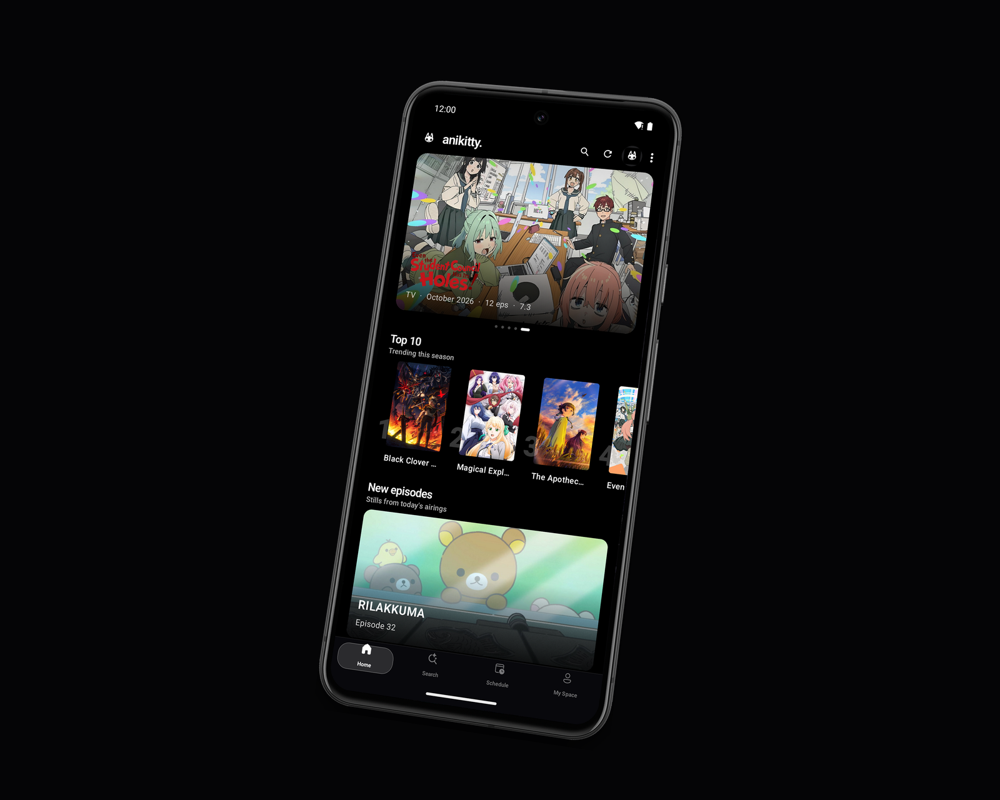
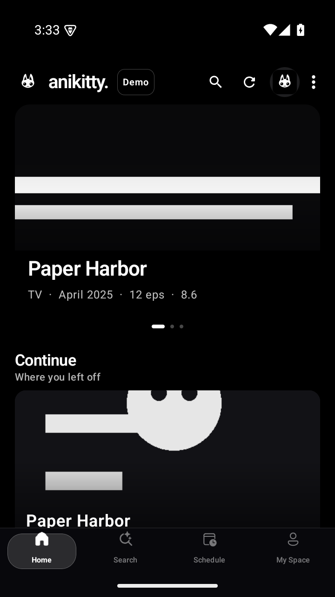
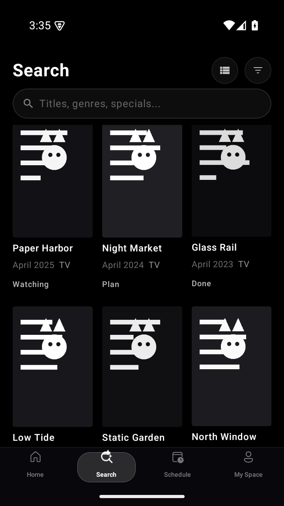
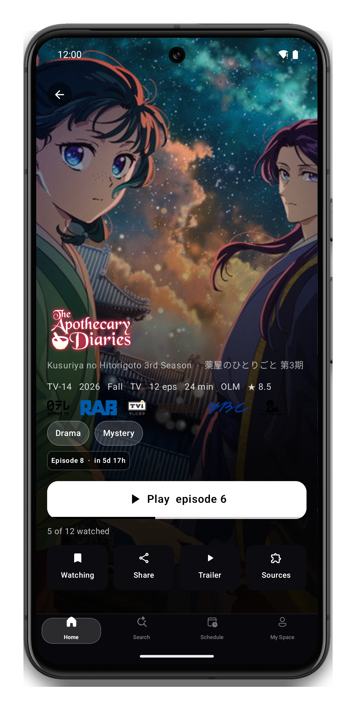
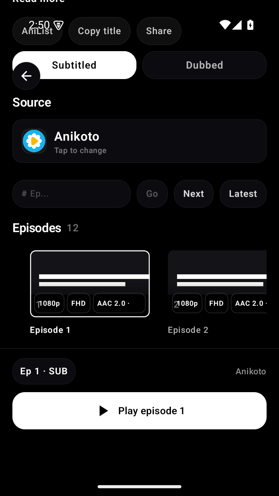
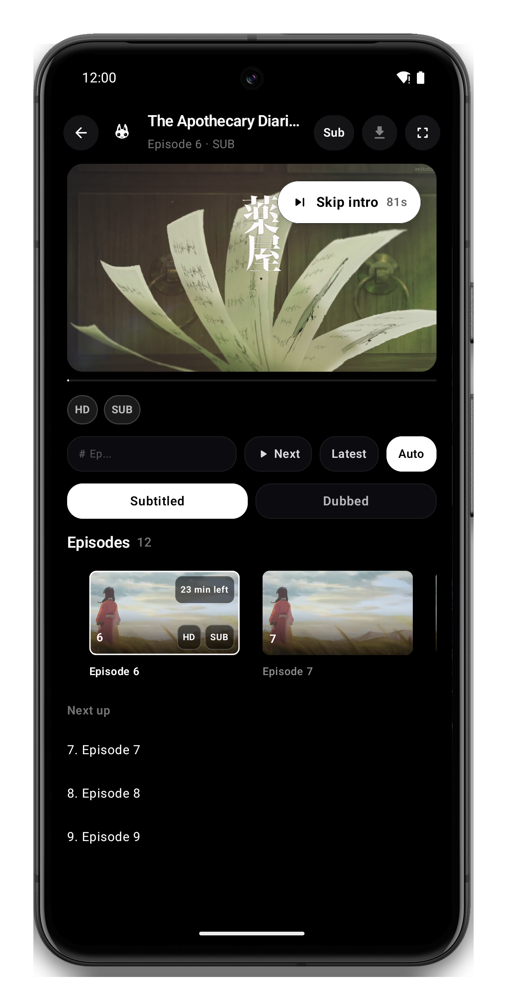
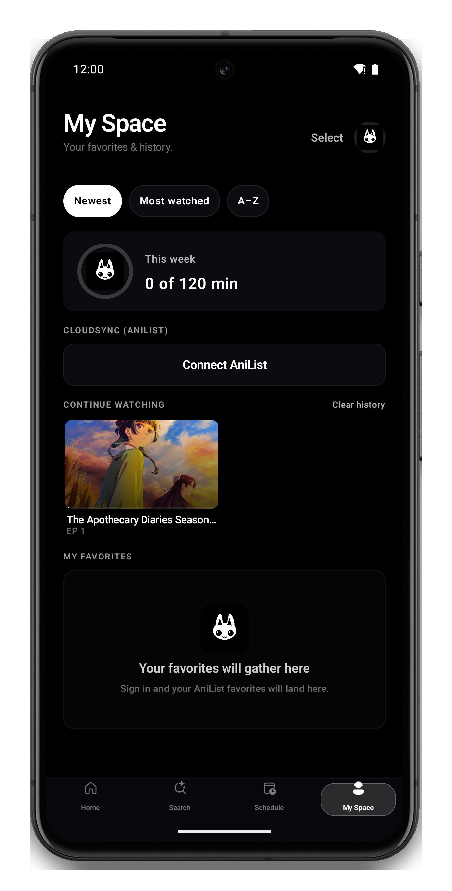

<div align="center">
  

  <h1>AniKitty</h1>

  <p>Your AniList, on the phone. The catalog comes from AniList. The video plays with Media3.</p>

  <p>
    <a href="https://github.com/fampep/anikitty/releases/latest"></a>
    <a href="https://github.com/fampep/anikitty/releases"></a>
    <a href="https://github.com/fampep/anikitty/releases/latest"></a>
    <a href="https://github.com/fampep/anikitty/releases"></a>
    <a href="https://github.com/fampep/anikitty/releases"></a>
    <a href="https://github.com/fampep/anikitty/actions/workflows/dev-release.yml"></a>
    <a href="https://github.com/fampep/anikitty/blob/main/LICENSE"></a>
    
  </p>
</div>

> [!WARNING]
> AniKitty is an unofficial app. It is not affiliated with AniList, MyAnimeList, or any studio or streaming service. Sideload APKs only from the [official releases](https://github.com/fampep/anikitty/releases) of this repository. Dev builds can be unstable.

<p align="center">
  
</p>

## Why AniKitty

- The catalog is AniList. Search, the season, and a title page all use it.
- The player is Media3, on the phone.
- Watch progress stays on the device. Sign in when you want that progress on your AniList list.
- **Anikoto**, **Gotaku**, and **Ani.pm** are compiled in, so a fresh install can play.
- Anything else is an extension you add. The app does not preload a community extension.

## Download

Package `site.anikitty.app`. Android 8 or newer.

A push to `main` publishes a signed dev build. Those land roughly every day. Stable releases are cut less often. Dev builds are newer and can be unstable. The badges above follow the releases. Nothing in this file hard-codes a version.

<p align="center">
  <a href="https://github.com/fampep/anikitty/releases/latest"></a>
  &nbsp;
  <a href="https://github.com/fampep/anikitty/releases/download/dev/anikitty-dev.apk"></a>
</p>

Stable opens the latest stable release. Dev downloads `anikitty-dev.apk`, a rolling build that moves with `main`. Numbered builds stay on the [releases page](https://github.com/fampep/anikitty/releases).

Allow installs from the browser, then open the file. If Android refuses an update because the signature does not match, uninstall the old app first.

## Screenshots

Public AniList catalog, night theme, on a Pixel-sized screen. This is not a signed-in account, and it is not the sample library. How to take the shots again is in [docs/screenshots/README.md](docs/screenshots/README.md). The frames are Google's Pixel 8 device art. Do not use those framed files in a Play listing.

<table>
  <tr>
    <td></td>
    <td></td>
    <td></td>
  </tr>
  <tr>
    <td align="center">Home</td>
    <td align="center">Search</td>
    <td align="center">Title</td>
  </tr>
  <tr>
    <td></td>
    <td></td>
    <td></td>
  </tr>
  <tr>
    <td align="center">Episodes</td>
    <td align="center">Player</td>
    <td align="center">My Space</td>
  </tr>
</table>

## Features

- Home shows a featured title, a large continue card, what is airing, and this season.
- Search filters the AniList catalog and offers live title suggestions as you type.
- A title page resumes at the saved position. The button shows the exact time.
- The player is Media3. Double-tap either side to skip 10 seconds. Hold to play faster. Swipe down on the page bar or the episode shelf to leave for the library.
- Episodes are a thumbnail row. The current one shows minutes left. The next three sit underneath. Swipe a thumbnail up to mark it watched or unwatched.
- Sub and dub are a chip on the player bar. Autoplay shows a countdown you can dismiss.
- My Space sorts the library by newest, most watched, or name, and shows minutes logged this week.
- Settings can open the player full screen, pick an accent for the dark theme, remind you about a show you left, and export watch progress as JSON. The export does not include the AniList token.
- The player chrome stays dark. The rest of the app follows the system theme. Reduced motion turns off the extra movement.

The download icon on the player is a stub. AniKitty streams. It does not save the episode.

## Extensions

Only a resolver can supply a stream. The app sends an AniList id, an episode number, the audio mode, and a title hint. The resolver returns URLs. Media3 plays one of them. A community extension is an HTTP manifest (`anikitty-extension.json`), not code loaded into the app. It does not receive the AniList token.

| | |
|---|---|
| Author guide | [`extensions/GUIDE.md`](extensions/GUIDE.md) |
| Protocol | [`extensions/spec/PROTOCOL.md`](extensions/spec/PROTOCOL.md) |
| Submit a listing | [`extensions/store/SUBMIT.md`](extensions/store/SUBMIT.md) |
| Public index | [`fampep/anikitty-extensions`](https://github.com/fampep/anikitty-extensions) |
| Disclaimer | [`extensions/DISCLAIMER.md`](extensions/DISCLAIMER.md) |

## Build from source

```bash
cd apps/android
./gradlew :app:assembleRelease
```

The APK is `apps/android/app/build/outputs/apk/release/`. The version comes from the repo-root [`VERSION`](VERSION) file. GitHub Actions bumps that file when it publishes a dev prerelease. It does not edit this README.

| | |
|---|---|
| App | Kotlin, Jetpack Compose, Media3, Room |
| Catalog | AniList GraphQL |
| Sources | `extensions/` — guide, protocol, and store index |
| Bundled resolvers | Anikoto, Gotaku, Ani.pm |

## FAQ

<details>
<summary>Is AniKitty an official AniList app?</summary>

No. AniKitty is an unofficial client. It is not affiliated with AniList, MyAnimeList, or any studio or streaming service.
</details>

<details>
<summary>Where should I download it?</summary>

Only from the <a href="https://github.com/fampep/anikitty/releases">releases of this repository</a>. Stable is <a href="https://github.com/fampep/anikitty/releases/latest">the latest stable release</a>. The rolling dev file is <a href="https://github.com/fampep/anikitty/releases/download/dev/anikitty-dev.apk"><code>anikitty-dev.apk</code></a>.
</details>

<details>
<summary>How often is it updated?</summary>

A push to <code>main</code> publishes a signed dev build. Those land roughly every day. Stable releases are cut less often.
</details>

<details>
<summary>Does the app host episodes?</summary>

No. AniKitty does not host, store, or ship video, and it does not keep a downloaded copy. A resolver returns a URL. Media3 plays it.
</details>

<details>
<summary>Do I need an AniList account?</summary>

No. The public catalog loads without one. Sign in when you want list sync. Sign-in is AniList's implicit grant, client id 56768, redirect <code>anikitty://anilist</code>. There is no client secret in the APK.
</details>

## Contributing

Pull requests are welcome. Read [CONTRIBUTING.md](CONTRIBUTING.md). A new stream source belongs in the [author guide](extensions/GUIDE.md) and a store submission, not inside the player. Questions and bugs go in [GitHub issues](https://github.com/fampep/anikitty/issues). Chat is on [Telegram](https://t.me/Anikittymoe).

<div align="center">
  <a href="https://ko-fi.com/E6C820K9H8"></a>
</div>

## License

Copyright 2026 fampep. [Apache License 2.0](LICENSE).

You can use, copy, change, and share this project, including in a product. Keep the copyright and the license with it ([`NOTICE`](NOTICE)), and say which files you changed. The license does not grant the AniKitty name as a trademark, does not cover a community extension or the video it points at, and does not promise that a title will play.

## Disclaimer

AniKitty does not host video. It does not store, provide, or ship episodes, and it does not keep a downloaded copy. Media3 plays a URL after a resolver returns one.

**Anikoto**, **Gotaku**, and **Ani.pm** are compiled into the app as resolvers, so a fresh install can play. They are not a video library, and this repository does not operate the sites they call. Any other source is a community extension you add. Those extensions are not maintained as content here. A listing in the store index does not make the maintainers the operator of that author's service. See [`extensions/DISCLAIMER.md`](extensions/DISCLAIMER.md).

The maintainers do not control the media those sources point at, and they do not endorse it. You choose the source. You have to follow the law that applies to you.

AniList, MyAnimeList, and the names of studios and streaming services are trademarks of their owners. The [Apache License 2.0](LICENSE) does not grant the AniKitty name as a trademark.

The software is provided **as is**, without warranty of any kind, under the Apache License 2.0. Sections 7 and 8 of the [LICENSE](LICENSE) are the warranty disclaimer and the limitation of liability.

## DMCA

A takedown for a video goes to the provider that hosts that video. This repository does not host the file.

A notice about this repository — the app source, the docs, or a link published here — belongs in [GitHub issues](https://github.com/fampep/anikitty/issues). The repository does not list a separate security email. Include the URL, the work you own, and the change you are asking for.

## Privacy

AniKitty has no account server. The phone keeps watch progress in a local database. The JSON export of that progress includes the AniList id, title, episode, position, list status, and MAL id. It does not include the AniList token.

Sign-in is optional. The token from AniList's implicit grant is stored encrypted on the phone. While you are signed in, the app sends that token only to `https://graphql.anilist.co`, for your profile, list, favourites, and list updates. Catalog requests without a token are anonymous.

A stream request sends the AniList id, episode number, audio mode, and title hint to the resolver you are using. It does not send the AniList token.

Cover images load from the URLs AniList returns. If a TMDB or Fanart key is present, the app may also request backdrop art from those services. The update check reads the public releases of this repository and can download an APK from one of them.
