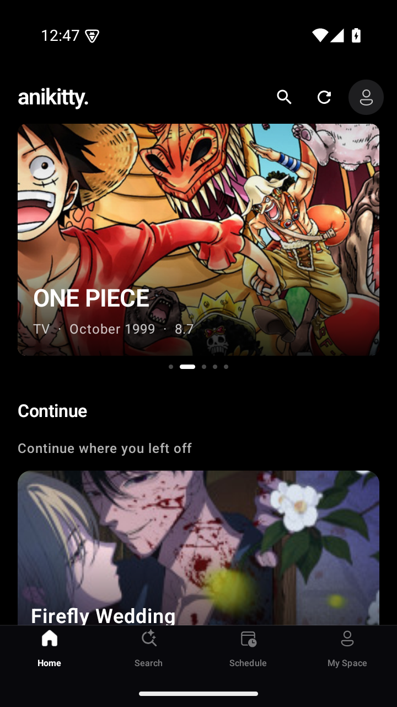
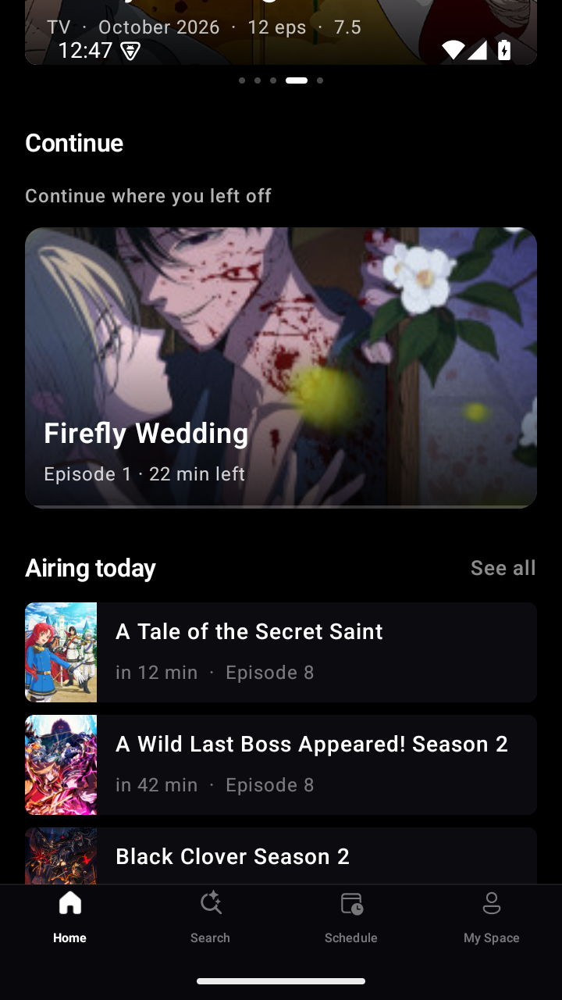
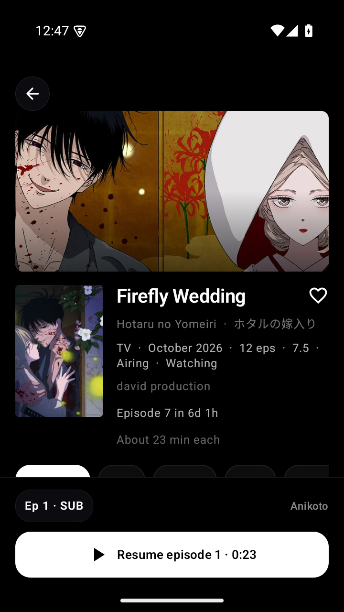
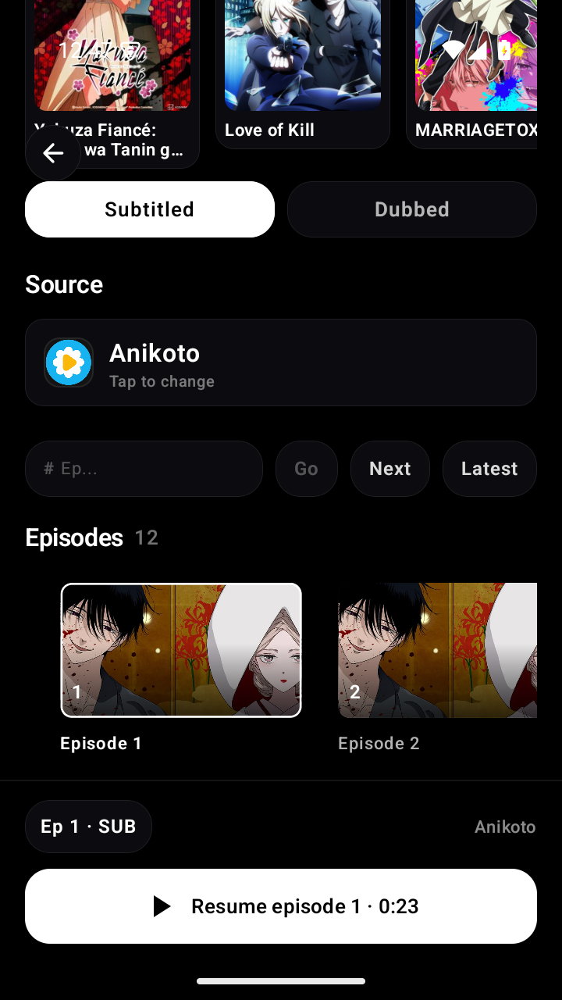
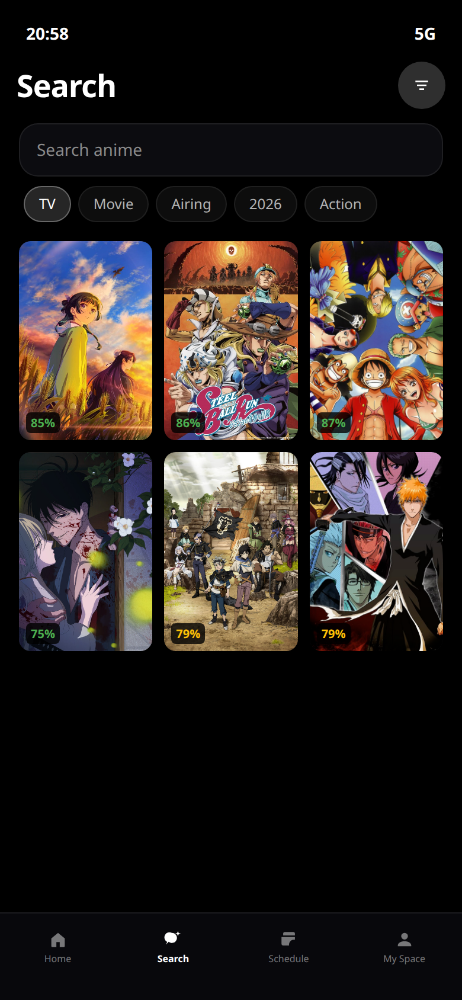
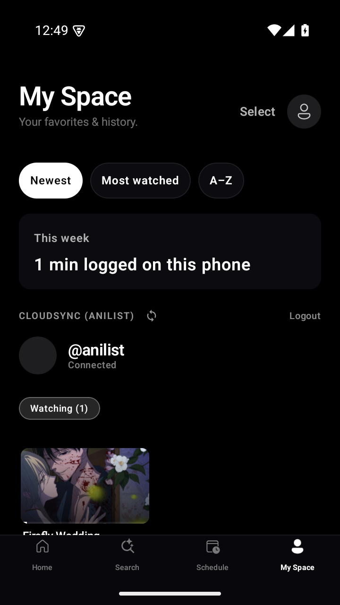
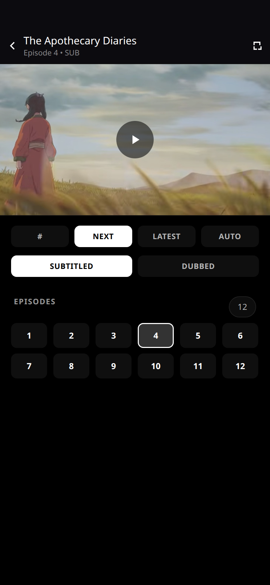
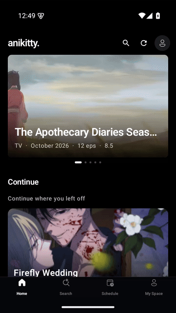

<div align="center">
  

  <h1>AniKitty</h1>

  <p>A phone app for your AniList. The catalog comes from AniList. The video plays on the phone with Media3.</p>

  <p>
    <a href="https://github.com/fampep/anikitty/releases/latest"></a>
    <a href="https://github.com/fampep/anikitty/blob/main/LICENSE"></a>
    
  </p>
</div>

AniKitty is local-first. Sign-in is AniList only (implicit grant, client id 56768, redirect `anikitty://anilist`). There is no client secret in the APK. Watch progress stays on the phone and can sync to your AniList list.

A stream does not ship with the app. Media3 plays a URL after a resolver returns one. The default APK does not preload a community extension. **Anikoto**, **Gotaku**, and **Ani.pm** are compiled in, so a fresh install can still play. Anything else is an extension you add yourself.

> [!IMPORTANT]
> AniKitty does not host video. It does not store, provide, or ship episodes, and it does not keep a downloaded copy. You choose the source. You have to follow the law that applies to you. The app is provided as is under the [Apache License 2.0](LICENSE).

## Install

Sideload the stable APK. Package `site.anikitty.app`. Android 8 or newer.

**[anikitty-1.2.4.apk](https://github.com/fampep/anikitty/releases/download/v1.2.4/anikitty-1.2.4.apk)**

Allow installs from the browser, then open the file. If Android refuses an update because the signature does not match, uninstall the old app first.

Pushes to `main` also publish a signed **dev prerelease**. Those builds are newer and less settled. They are on the [releases page](https://github.com/fampep/anikitty/releases), marked as prereleases. The badge above stays on the latest stable tag.

## Screenshots

<table>
  <tr>
    <td></td>
    <td></td>
    <td></td>
  </tr>
  <tr>
    <td align="center">Home</td>
    <td align="center">Continue</td>
    <td align="center">Title</td>
  </tr>
  <tr>
    <td></td>
    <td></td>
    <td></td>
  </tr>
  <tr>
    <td align="center">Episodes</td>
    <td align="center">Search</td>
    <td align="center">My Space</td>
  </tr>
  <tr>
    <td colspan="3" align="center"></td>
  </tr>
  <tr>
    <td colspan="3" align="center">Player</td>
  </tr>
</table>

<p align="center">
  
</p>

## What you can do

- Home shows a featured title, a large continue card, what is airing, and this season.
- Search filters the AniList catalog and offers live title suggestions as you type.
- A title page resumes at the saved position. The button shows the exact time.
- The player is Media3. Double-tap either side to skip 10 seconds. Hold to play faster. Swipe down on the page bar or the episode shelf to leave for the library.
- Episodes are a thumbnail row. The current one shows minutes left. The next three sit underneath. Swipe a thumbnail up to mark it watched or unwatched.
- Sub and dub are a chip on the player bar. Autoplay shows a countdown you can dismiss.
- My Space sorts the library by newest, most watched, or name, and shows minutes logged this week.
- Settings can open the player full screen, pick an accent for the dark theme, remind you about a show you left, and export watch progress as JSON. The export does not include the AniList token.
- The player chrome stays dark. The rest of the app follows the system theme. Reduced motion turns off the extra movement.

The download icon on the player is a stub. AniKitty streams. It does not save the episode.

## Build

```bash
cd apps/android
./gradlew :app:assembleRelease
```

The APK is `apps/android/app/build/outputs/apk/release/`. The version comes from the repo-root [`VERSION`](VERSION) file. GitHub Actions bumps that file when it publishes a dev prerelease.

| | |
|---|---|
| App | Kotlin, Jetpack Compose, Media3, Room |
| Catalog | AniList GraphQL |
| Sources | `extensions/` — guide, protocol, and store index |
| Bundled resolvers | Anikoto, Gotaku, Ani.pm |

## Extensions

Only a resolver can supply a stream. The app sends an AniList id and an episode number. The resolver returns URLs. Media3 plays one of them. A community extension is an HTTP manifest (`anikitty-extension.json`), not code loaded into the app. It never receives an AniList password.

| | |
|---|---|
| Author guide | [`extensions/GUIDE.md`](extensions/GUIDE.md) |
| Protocol | [`extensions/spec/PROTOCOL.md`](extensions/spec/PROTOCOL.md) |
| Submit a listing | [`extensions/store/SUBMIT.md`](extensions/store/SUBMIT.md) |
| Public index | [`fampep/anikitty-extensions`](https://github.com/fampep/anikitty-extensions) |
| Disclaimer | [`extensions/DISCLAIMER.md`](extensions/DISCLAIMER.md) |

## Contributing

Pull requests are welcome. A new stream source belongs in the [author guide](extensions/GUIDE.md) and a store submission, not inside the player. Questions and bugs go in [GitHub issues](https://github.com/fampep/anikitty/issues). Chat is on [Telegram](https://t.me/Anikittymoe).

## License

Copyright 2026 fampep. [Apache License 2.0](LICENSE).

You can use, copy, change, and share this project, including in a product. Keep the copyright and the license with it ([`NOTICE`](NOTICE)), and say which files you changed. The license does not grant the AniKitty name as a trademark, does not cover a community extension or the video it points at, and does not promise that a title will play.

<div align="center">
  <a href="https://ko-fi.com/E6C820K9H8"></a>
</div>
